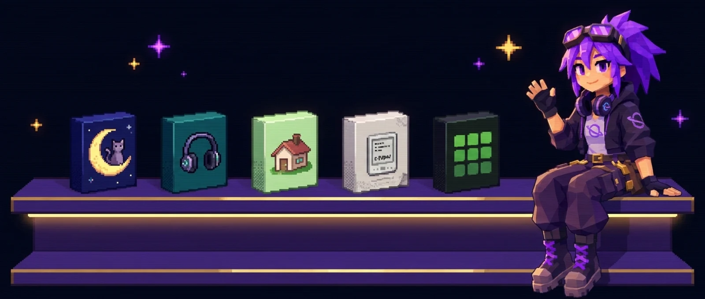

  

  <b>Odd, specific, well-finished software for real situations.</b> 
  <a href="https://oddorbit.software">oddorbit.software</a> ·
  <a href="https://oddorbit.software/contact/">Get in touch</a>

  

Hi, we're Odd Orbit. We build things like an audiobook player for the TV and the sofa, a text-adventure engine with a block editor, a Sudoku for your terminal, an e-paper display for a Raspberry Pi, and a website a residents' committee can run without a developer. Each one goes from first commit to release with tests, docs and CI.

## On the shelf

| | Project | What it does | Status |
|---|---|---|---|
| 🌙 | **[Luna Engine](https://github.com/Odd-Orbit-Software/luna-engine)** | Build parser-driven text adventures with drag-and-drop blocks, then play them in a terminal. Rust engine, Blockly editor. [Docs](https://odd-orbit-software.github.io/luna-engine/) · [Download](https://github.com/Odd-Orbit-Software/luna-engine/releases/latest) | Released, 1.0.1 |
| 🎧 | **[Vox Folio](https://github.com/Odd-Orbit-Software/Vox-Folio)** | Your Audiobookshelf library on an LG webOS TV, made for the remote and the sofa. Chapters, bookmarks, sleep timer, profiles. [Docs](https://odd-orbit-software.github.io/Vox-Folio/) · [Download](https://github.com/Odd-Orbit-Software/Vox-Folio/releases/latest) | Released, 0.12.0 |
| 🔢 | **[Sudoku](https://github.com/Odd-Orbit-Software/sudoku-term)** | Sudoku in your terminal, with four difficulties, pencil notes, hints, undo and a save after every move. Written in Go. [Download](https://github.com/Odd-Orbit-Software/sudoku-term/releases/latest) | Released, 1.0.0 |
| 🗞️ | **[Paperphase](https://github.com/Odd-Orbit-Software/Paperphase)** | A calm e-paper information display for the Raspberry Pi: weather, calendars and the next Luas. Rust service, WebAssembly plugins, browser layout editor. | In progress, 0.1.0 |
| 🏡 | **[Drynam Hall Connect](https://drynamhall.ie)** | The website and admin system we built for the Drynam Hall Residents' Association. The committee runs it themselves. React, FastAPI, Docker. | Live (client build) |

Each project has its own repo, docs and releases. The [site](https://oddorbit.software) has a page for every one, with screenshots.

## Need something built?

If your club, community group or small organisation needs a site and an admin system you can run yourselves, [send us a note](https://oddorbit.software/contact/). Drynam Hall Connect shows the kind of thing we'd make.

   
  That's Orbi. She keeps the workshop running.

